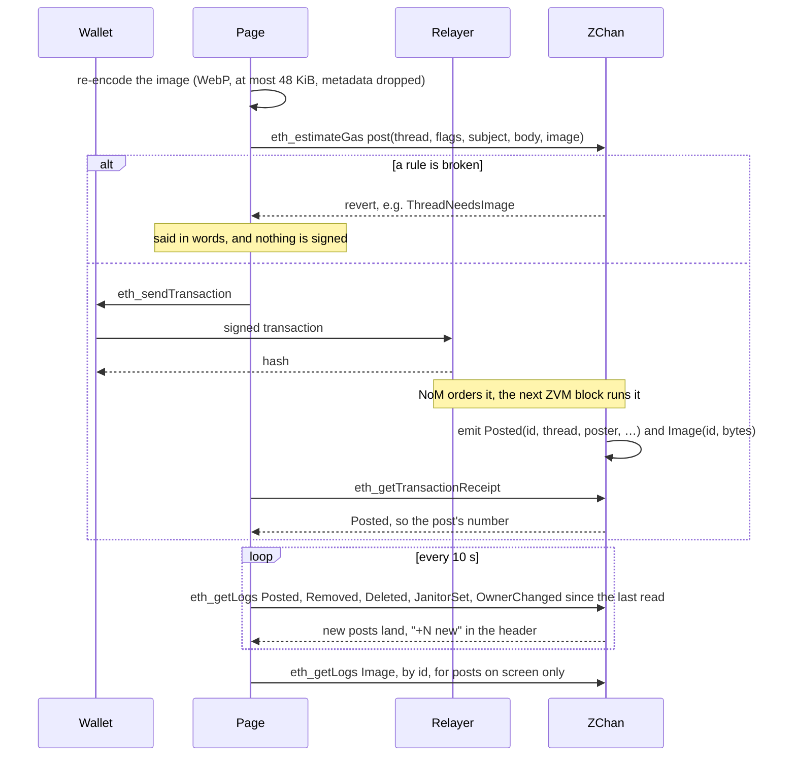

# zvm-zchan guide

zchan is one anonymous image board, `/z/`, kept entirely in a contract on
a ZVM. Every post is a transaction from an EVM wallet; the page reads the board
straight from the chain's logs, so there is no server, no database and nothing
to host but static files. It was first deployed at devnet.zenon.foo, and the
same build publishes to GitHub Pages.

- `contracts/`: `ZChan.sol`, and the scripts that build, deploy and check it
- `web/`: the page, a static build for GitHub Pages (or any static host)
- `deployments/zvm.json`: what is deployed where, written by the deploy; kept out of git, as every devnet deploys its own
- `secrets/zchan.json`: the deploy-time owner's key and the janitor's key;
  git-ignored. The owner's key no longer owns anything: ownership passed to
  `0xE5Ef…8E9b` with `setOwner`.

| | First deployment (chain 7340469) |
|---|---|
| ZChan | `0x1f045d255a94187dde673a49ab1d060e5667ff76` |
| Owner | `0xE5Ef96Ac84e8fFDBD83f07Cd7e1c23A144498E9b` |
| First janitor | `0x76a67cad9B882EAc3714FF6499D961dDBb9CA1E0` |

The contract is verified on the explorer with an exact match. Three earlier
boards were replaced as features arrived, and their posts are not carried over
(only a post's own wallet could post it again): the first had no handles, owner
or removal; the second no deleting one's own post (its fees were withdrawn);
the third gave a wallet the same code signed and anonymous.

## A post, and how the page finds it



The text of the whole board is one pass over `Posted` logs; images are separate
`Image` logs, fetched only for posts about to be seen, up to 24 per request.
The contract stores almost nothing: the post count, which ids opened threads,
who sent each post (privately, so only they can delete it), which were removed
or deleted, who holds which handle, and who the janitors are.

The board is read again every ten seconds, not reloaded, so a half-written post
and the scroll position stay put. A post that arrives settles in with a short
rise and a fading tint, and "+N new" appears beside the head (and in the tab's
title while it is in the background) so a post that lands off-screen is still
seen.

An image is shown only as JPEG, PNG, GIF or WebP, recognised by its first
bytes, never by what a poster claims, so an SVG or HTML file can never run in
the page. Everything a poster wrote reaches the page as text nodes.

## Rules

The contract refuses, whatever the page does:

- a thread without an image; a subject over 100 bytes; a comment over 4,000
  bytes; an image over 64 KiB;
- a reply to a thread that does not exist, was removed, or was deleted; a
  reply with a subject; a reply with neither comment nor image;
- deleting a post the sender did not send;
- a signed post from a wallet with no handle.

Bump order, the 300-reply bump limit, sage, ten threads a page with their last
five replies, backlinks and greentext are 4chan's, and are the page's.

## Anonymity

Posters show as `Anonymous` with an eight-character ID per thread, derived from
the wallet, the thread, and whether the post is signed with a handle, as 4chan's
per-thread IDs are: one wallet reads as the same ID within a thread and as
unrelated IDs across threads, and its signed and anonymous posts in one thread
carry two unrelated IDs, so signing a post never marks the wallet's anonymous
ones. The page never
shows an address. The chain does: every post is a transaction its wallet sent,
so anyone can link a wallet's posts by reading the chain. The page says so, and
suggests a wallet used for nothing else.

## Handles

A handle is this board's tripcode. A wallet registers a name for **1 ZNN**
(`register(name)`), 2 to 16 characters of `A-Z a-z 0-9 _`, unique without
regard to case. A name is held by its wallet for good, so a handle on a post
always means the same poster, which is what a tripcode proves. A wallet can hold
several names; choosing one it already holds again is free.

Holding a handle unmasks nothing. Each post chooses between the handle and
Anonymous (the `NAMED` flag), and the form starts at Anonymous every time. A
signed post shows the name in plasma pink with a diamond, set apart from
`Anonymous`.

When the owner or a janitor signs a post with their handle, it reads in Bitcoin
orange with a capcode, `## Admin` or `## Janitor`, as a 4chan moderator posting
as one. Staff who post as Anonymous stay anonymous: the page matches a post to
the staff addresses only when the post is signed. This is how the owner posts as
Admin: the form's "Post as" names the capcode for a staff wallet ("sol ## Admin",
"janitor ## Janitor"), beside Anonymous. The handle `admin` itself is not
reserved; anyone may register it, but only staff wallets ever get the orange
capcode.

## Deleting your own post

`deletePost(id)` takes a post off the board for good, and only its sender may
call it (the contract keeps each post's sender for this). On the page, your own
posts carry a `delete` button that asks a second time. A deleted first post
closes its thread, as a removal does, and no janitor can restore it. The post is
still in the chain's history, like everything else.

## Owner and janitors

- The **owner** takes the fees (`withdraw(to, amount)`, 0 for everything),
  appoints and dismisses janitors (`setJanitor(address, bool)`), and can hand
  the board on (`setOwner`). The deployer is zvm's public devnet key 900, which
  holds no role.
- A **janitor** removes a post (`remove(id, true)`) or restores it. A removed
  post is gone from the page for every visitor, a removed first post takes its
  thread with it, and the contract refuses further replies to a removed thread.
  What was posted stays in the chain's history: no contract can erase a log.

Who can take a post down, and nobody else: its own poster (`deletePost`) and
any janitor (`remove`). Owning the board does not make a wallet a janitor, so
the owner's tools offer "Appoint yourself janitor", one `setJanitor` call.
`setJanitor`, `setOwner` and `withdraw` answer to the owner alone.

Both have a page: the Handle page (in the header) shows the janitors to everyone, and the
owner's tools (fees held, withdraw, appoint, dismiss) to the owner's wallet. A
janitor's wallet sees `remove` and `restore` beside every post, and removed
posts dimmed rather than gone. To use either role, import its key from
`secrets/zchan69.json` into a wallet.

## Running it

```sh
cd contracts && npm install
npm run build            # ZChan.sol -> out/ZChan.json, and web/src/abi.ts
npm run keys             # secrets/zchan69.json; refuses to overwrite
npm run deploy           # funds both roles from dev key 900, deploys, verifies
npm run check            # every rule above, as eth_calls, spending nothing
```

`deploy` resumes: each step checks the chain first. It writes
`deployments/zvm.json`, which the page compiles in.

```sh
cd web && npm install
npm run dev              # http://localhost:47620/
npm run build && npm run preview   # the static build on :47621
npm run verify           # the live check, below
```

The page reads the node `VITE_ZVM_NODE` names at build time (no node is built
in, and the build stops without it; `.env.example` has a local zvm-devnet's,
which answers any origin), so the same build works from GitHub Pages. Behind a
ZVM gateway it is one of the static sites, and `zvm-status`
probes it as the zchan row. `?rpc=<url>` points one visit at another node of
chain 69. The build
uses relative paths and hash routes (`#/catalog`, `#/thread/12/p15`), so it
serves unchanged from a project path, a domain's root, or a gateway path.
`.github/workflows/pages.yml` publishes `web/dist` on every push to `main`, built
with the organisation's `ZVM_NODE` and `ZVM_GATEWAY` Actions variables (Pages
must be set to "GitHub Actions" in the repository's settings).

`npm run verify` drives the built page in headless Chrome with a stand-in
wallet the node's faucet funds, and posts for real on chain 69: it opens a
thread with an image, quotes it from the quick reply, registers a handle, posts
once with it and once without, deletes its own anonymous post, has the janitor
reply from another wallet, signed as staff, to see "+1 new" arrive in orange,
checks the About page, the catalog, the light theme and a 400 px phone, and
removes its thread at the end so the board stays clean. Pass a public RPC and
that gateway's `/zchan/` to run it against a hosted copy (an https
page cannot be pointed at a local http node). It spends about 1.2 ZNN
of faucet money a run, most of it the handle. Every page stays in motion
whatever the OS reduced-motion setting says (the root `CLAUDE.md`, Motion).
